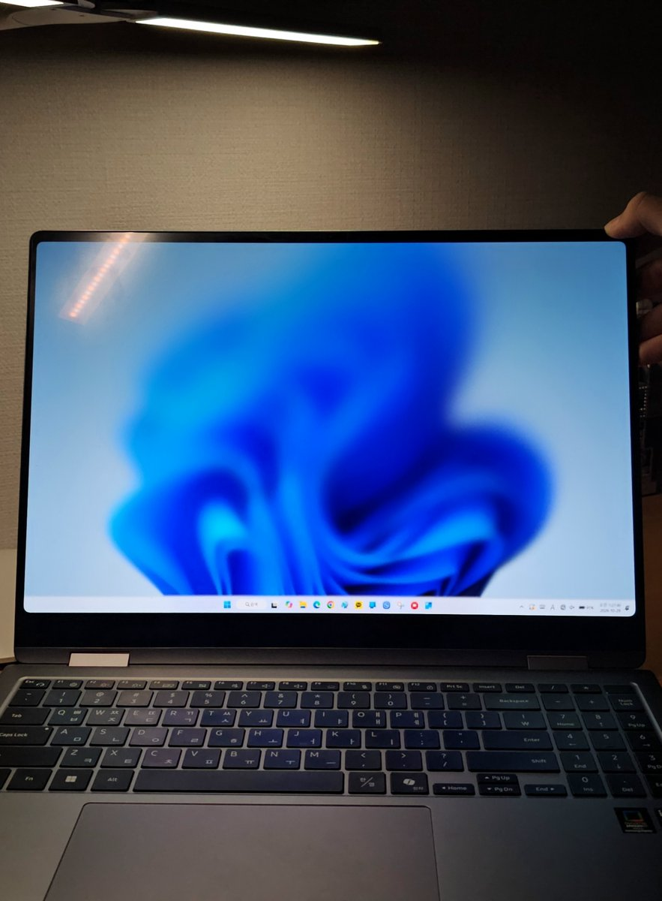
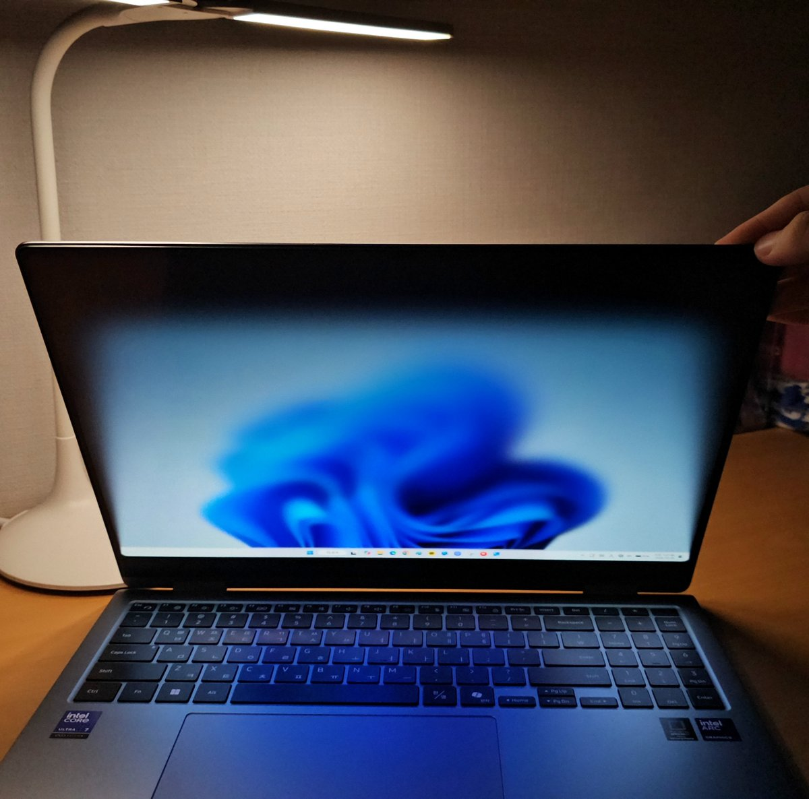

# WinDuo2

Close your laptop lid and the screen leans away, blurring and dimming as it goes, the way an iPhone Duo does as it folds shut. Open it again and the screen stands back up out of the blur.

| Lid open | Closing |
| :---: | :---: |
|  |  |

WinDuo2 reads the laptop's own hinge angle sensor: the one Windows exposes as standard, or the Intel Integrated Sensor Hub's hinge sensor on convertibles such as the Galaxy Book 360 series. No camera, no calibration.

Windows 10 (2004+) and 11 · Free for noncommercial use, [PolyForm Noncommercial 1.0.0](LICENSE.md)

## Install

**Just want to use it:** download `WinDuo2.exe` from the [latest release](https://github.com/minjoon5/WinDuo2/releases/latest). One native file of about two megabytes, nothing else to install. Windows will warn about an unrecognised app because the build is unsigned — choose *More info*, then *Run anyway*.

**To blur Start and quick settings too:** install with `WinDuo2-Setup.exe` from the same release instead. It installs under Program Files with *uiAccess*, which puts the effect above Start, search, the notification centre and quick settings, so they stay open and blur with everything else instead of closing. Windows only grants uiAccess to an exe signed by a certificate the PC trusts and installed under Program Files, and refuses to start it otherwise. The installer takes care of both: it installs under Program Files and, with *Sign WinDuo2 with a certificate made on this PC* left ticked, signs the exe with a certificate it makes on your PC, again on every update. **[docs/uiaccess.md](docs/uiaccess.md)** has the details, signing through CI instead, starting at sign-in, checking it works, and uninstalling.

**From source:** with Visual Studio's C++ tools and CMake, run `native/build.ps1`. It builds `native/build/app/plain/WinDuo2.exe`, and the uiAccess variant beside it.

WinDuo2 sits in the notification area. Right-click it for settings. *Start with Windows* is on from the first run, so it runs every time you sign in; untick it in the settings to stop that. It is registered as a *WinDuo2* task in Task Scheduler that runs as soon as you sign in, rather than as a Task Manager startup app, which Windows holds back for a while after sign-in; it waits only for the taskbar to appear. The settings window opens by itself only the very first time WinDuo2 runs, never at sign-in.

To check that your laptop has a sensor WinDuo2 can read, run `WinDuo2.exe --sensors` from a terminal and move the lid: it prints the angle it sees for twenty seconds. `WinDuo2.exe --preview` plays the effect once on whatever is on screen.

## How it follows the lid

The effect is continuous, not a one-shot animation. It fades in once you have closed about 5°, grows as you keep closing, reaches full strength at about 80°, and holds there for the rest of the way down. Open back up and it reverses. Both thresholds are adjustable.

Opening has an effect of its own, the mirror of a close. Open a lid that was partly closed, or tilt an open screen further back, and once it has opened about 5° the picture starts to spread: its top edge widens past both sides of the screen and runs up past the top, with the bottom edge held on the hinge, growing as you keep opening and reaching full strength at about 80°. When the lid comes to rest it eases back into place.

Lifting the lid from fully shut is different: it plays the close backwards. The picture starts leaned back, blurred and dimmed, the way a close ends, and stands back up as the lid rises, flat again by the angle the lid was last open at. Opening past that angle does not spread it, and stopping short eases it back into place. A lid counts as shut when Windows reports it closed or it has rested below 20°.

The picture behaves like a sheet hinged at the bottom of the screen that leans back as the lid closes, so its top edge comes down and narrows. By default it leans back at 0.8° per degree of closing, and the tilt levels off at about 55° past the trigger instead of stretching the picture into a smear as the lid nears flat. *Lean back* and *Tilt limit* in the settings adjust both.

The angle comes from the first of these the laptop offers:

1. **Windows' hinge angle sensor** (`Windows.Devices.Sensors.HingeAngleSensor`), which reports the angle between lid and base directly.
2. **The Intel ISH hinge sensor**, a custom sensor (`Windows.Devices.Sensors.Custom`, HID usage 0x020B) that Galaxy Book 360 models expose instead. The sensor hub's firmware works the angle out from the accelerometers in both the lid and the base, so it is the true hinge angle with the laptop on a lap or a tilted desk.

Whenever the lid holds still, that position becomes zero, and the effect runs on movement away from it. A lid that stops partway becomes the new zero, so the effect eases out on its own.

## How it draws

WinDuo2 is native C++ throughout (`native/`): the effect's logic in `native/core`, the sensors, tray and settings in `native/app`, and a Direct3D 11 renderer in `native/winduo2_native.cpp`. The screen is captured with Desktop Duplication and never leaves the graphics card: it is scaled, its blur levels are built and the effect is drawn there, and the overlay is a DirectComposition surface that Windows composes directly, with fades that Windows runs by itself. It draws at the display's own refresh rate, 120 frames a second on a 120 Hz panel.

After every run of the effect the log (`%APPDATA%\WinDuo2\winduo2.log`) has an `effect run:` line with the frame rate reached, how many frames missed their refresh, and where the time went.

## Known limits

- **It needs a hinge angle sensor.** Laptops without one, which includes most ordinary clamshells, are not supported, and WinDuo2 says so in the tray. The lid accelerometer alone is no longer used on Windows.
- **Folded past flat, it stays off,** so unfolding from tent or tablet mode does not count as closing.
- **Start, search and the notification flyouts close when the effect starts,** unless WinDuo2 was installed with `WinDuo2-Setup.exe` and is signed (see [docs/uiaccess.md](docs/uiaccess.md)). Windows keeps them in a layer above every window an ordinary app can make, so the portable exe cannot blur them in place; closing them is what the lid closing would do anyway. The lock screen is out of reach either way: it is a separate desktop no app can draw on. The pointer is hidden for the length of the effect and comes back when it ends. An app that draws a cursor of its own, as some games do, keeps it showing.
- **Windows turns the screen off when the lid shuts,** so you only see the effect during the closing movement.
- Primary display only, and only while it is upright: on a rotated screen the effect is off.

## Contributing

Build with `native/build.ps1`, then `native/build/app/plain/WinDuo2.exe --selftest`: it compiles every shader and draws real frames on WARP, Windows' software renderer, with no GPU or display needed, and runs a close through the effect's logic.

The app began in Python, and that implementation (`winduo2/`) is kept as the reference the C++ core is checked against: `pip install -e ".[dev]"` then `pytest` drives both with the same lid readings, step by step, and compares every estimate, decision and frame (`tests/test_core_parity.py`). The C++ core builds on Linux too, so this runs anywhere with g++.
